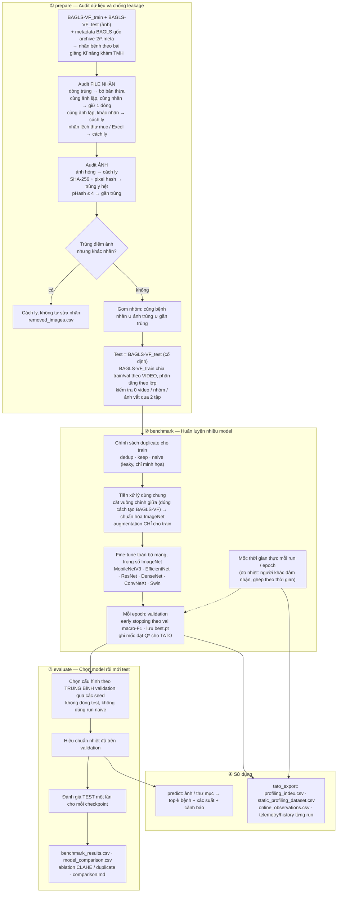

# Chẩn đoán ảnh nội soi họng – thanh quản: benchmark nhiều model + dữ liệu cho TATO

> ⚠️ Dự án **nghiên cứu**, không phải thiết bị y tế. Kết quả model chỉ là gợi ý cho bác sĩ, không thay thế khám lâm sàng và giải phẫu bệnh.

Pipeline làm 3 việc:

1. **Chẩn đoán ảnh**: đưa ảnh nội soi vào → model trả về top-k bệnh kèm xác suất (đã hiệu chuẩn) và cảnh báo.
2. **So sánh nhiều model** để chọn model tốt nhất: mỗi lần train ghi 1 dòng vào `benchmark_results.csv`; có bảng xếp hạng, so sánh **CLAHE bật/tắt** và **xử lý/không xử lý duplicate**.
3. **Sinh dữ liệu cho TATO**: mỗi lần train ghi cấu hình, chất lượng từng epoch, thời gian tới khi đạt chất lượng mục tiêu Q* và mốc thời gian thực. Phần đo nhiệt do người khác làm. Kết quả xuất đúng định dạng `profiling_index.csv` / `static_profiling_dataset.csv` mà TATO đang đọc.

---

## Mục lục

1. [Bắt đầu nhanh](#1-bắt-đầu-nhanh)
2. [Sơ đồ pipeline](#2-sơ-đồ-pipeline)
3. [Dữ liệu và phạm vi](#3-dữ-liệu-và-phạm-vi)
4. [Các bước chi tiết](#4-các-bước-chi-tiết)
5. [File kết quả](#5-file-kết-quả)
6. [Chống data leakage](#6-chống-data-leakage)
7. [Duplicate: xử lý và so sánh](#7-duplicate-xử-lý-và-so-sánh)
8. [CLAHE, early stopping, chọn model](#8-clahe-early-stopping-chọn-model)
9. [Kết nối TATO](#9-kết-nối-tato)
10. [Windows / NVIDIA / macOS và lỗi thường gặp](#10-windows--nvidia--macos-và-lỗi-thường-gặp)
11. [Cấu trúc thư mục](#11-cấu-trúc-thư-mục)
12. [Giới hạn](#12-giới-hạn)

---

## 1. Bắt đầu nhanh

### Cài đặt

```bash
# macOS / Linux
python3 -m venv .venv && source .venv/bin/activate
pip install -e ".[test]"

# Windows (PowerShell) — cài PyTorch bản CUDA trước theo https://pytorch.org/get-started/locally/
python -m venv .venv ; .venv\Scripts\activate
pip install -e ".[nvidia,test]"      # nvidia = telemetry GPU cho TATO (nvidia-ml-py)
```

> `.venv` hiện có được cài từ đường dẫn cũ (`~/Documents/ChatGPT/...`), nên **phải chạy lại `pip install -e .`** trong thư mục này (lệnh này cũng cài thêm `psutil`). Có thể kiểm tra bằng `pytest -q` (36 test, dữ liệu giả lập, khoảng 1 phút).

### Chạy

```bash
# 1) Ghép nhãn bệnh + audit + duplicate. Train = BAGLS-VF_train (tách 15% video làm validation), Test = BAGLS-VF_test
python -m throat_ai.prepare --task bagls_3class

# 2) Xem trước danh sách lần train (chưa train)
python -m throat_ai.benchmark --task bagls_3class --plan

# 3) Train toàn bộ: 9 model × duplicate dedup/keep, không CLAHE  (tự chọn model + test + báo cáo khi xong)
python -m throat_ai.benchmark --task bagls_3class

# 4) Phân đoạn 2 dây thanh + thanh môn (mask màu có sẵn) -> số đo -> dấu hiệu (xem mục 4b)
python -m throat_ai.seg_benchmark

# 5) Demo: ảnh ngẫu nhiên của tập test -> mask + dấu hiệu + nhóm bệnh
python -m throat_ai.demo --n 5

# 6) Chẩn đoán ảnh mới bằng model đã chọn
python -m throat_ai.predict duong_dan/anh_noi_soi.jpg
python -m throat_ai.predict thu_muc_anh/ --out ket_qua.csv
```

Kết quả nằm ở `outputs/bagls_3class/`: mở **`comparison.md`** (bảng so sánh) và **`benchmark_results.csv`** (mọi lần train).

---

## 2. Sơ đồ pipeline



> Sơ đồ hiển thị trực tiếp trên GitHub/GitLab; trong VS Code cần extension *Markdown Preview Mermaid Support*, hoặc dán khối trên vào https://mermaid.live.

---

## 3. Dữ liệu và phạm vi

### 3.1 Bộ dữ liệu: BAGLS-VF (chỉ dùng bộ này)

| Phần | Thư mục | Dùng để | Quy mô sau khi lọc |
|---|---|---|---|
| Train | `data/BAGLS-VF_train/BAGLS_image` | train + validation (tách **15% số video** làm val) | 538 video · 53.050 frame (mặc định lấy đều **20 frame/video** → ~10.760 ảnh) |
| Test | `data/BAGLS-VF_test/test_images` | **test cố định**, chỉ đánh giá 1 lần sau khi chọn model | 70 video · 3.500 ảnh (2.400 ảnh có nhãn bệnh) |

Bộ CE-NBI (Larynx) **không còn được dùng**. Các thư mục mask (`BAGLS_mask`, `test_masks`) không dùng cho phân loại.

**Nhãn bệnh lấy từ đâu:** BAGLS-VF chỉ có ảnh và mask phân đoạn, **không có nhãn bệnh**. Pipeline ghép mỗi ảnh với file `.meta` của bộ BAGLS gốc (`data/archive-2`):
- Ảnh train `ID<video>_<frame>_img_old_<idx>.png` → `archive-2/training/training/<idx>.meta`
- Ảnh test `<idx>.png` → `archive-2/test/test/<idx>.meta`

Tỷ lệ khớp là 100%, và mã video trong tên file trùng với `Video Id` trong metadata. Trường dùng làm nhãn là `"Subject disorder status"`, một chuỗi văn bản tự do với hơn 40 kiểu.

**Gom nhóm bệnh theo bài giảng "Kĩ năng khám Tai Mũi Họng"** (ĐH Y Dược TP.HCM). Logic ở `src/throat_ai/bagls.py`, phần dấu hiệu ở `src/throat_ai/knowledge.py`:

| Nhóm (task `bagls_3class`) | Theo bài giảng | Video train / test | Gồm |
|---|---|---|---|
| `Normal` – Thanh quản bình thường | tr.35: dây thanh trắng, mở hình tam giác khi hít vào, khép kín khi phát âm | 347 / 29 | healthy |
| `Organic_lesion` – Tổn thương thực thể | tr.37: hạt dây thanh, u hạt mấu thanh, u nhú, ung thư thanh quản | 46 / 11 | hạt (12), phù Reinke (8), polyp (6), u hạt (5), nang (3), viêm (3), sẹo/rãnh, u nhú, bạch sản, ung thư... |
| `Functional` – Rối loạn chức năng/vận động | không thấy khối; dây thanh khép/di động bất thường | 145 / 8 | căng cơ (124), teo, đóng thanh môn không kín, liệt, co thắt... |

- Task `bagls_binary` chỉ phân biệt Bình thường / Có bệnh lý.
- **Bị loại:** chẩn đoán trống (30 video train, 20 video test) và "None (sau điều trị…)" vì không rõ tình trạng hiện tại. Danh sách nằm trong `label_issues.csv`.
- **Không train từng bệnh riêng** (hạt, polyp, ung thư…) vì mỗi bệnh chỉ có 1–12 video. Tên bệnh cụ thể vẫn được giữ ở cột `histology` của manifest, và lệnh `demo` hiển thị kèm dấu hiệu tương ứng trong bài giảng.

**Phạm vi thật của model:** ảnh **nội soi tốc độ cao thanh môn**, chủ yếu ảnh xám (camera KayPentax/Wolf/Phantom). Một frame đơn lẻ chỉ thấy hình dạng dây thanh ở một thời điểm. Nhiều rối loạn chức năng (căng cơ, đóng thanh môn không kín) thể hiện qua **chuyển động** của dây thanh, nên phân loại từ 1 ảnh có giới hạn. Model không chẩn đoán vùng họng miệng (amidan, viêm họng).

**Tiền xử lý hình học:** BAGLS-VF tạo ảnh train 256×256 bằng cách *cắt hình vuông chính giữa* ảnh gốc (256×512, 256×320…) rồi resize; tôi đã kiểm chứng trên dữ liệu, sai số khoảng 0,2/255. Ảnh test lại giữ kích thước gốc, nên pipeline dùng `geometry: center_square` để xử lý ảnh test (và ảnh predict) **y hệt** cách đó.

### 3.2 Nguồn khác

[docs/DATA_SOURCES.md](docs/DATA_SOURCES.md) liệt kê các bộ ảnh họng/thanh quản khác đã tìm hiểu. Hiện **không dùng** bộ nào trong số đó.

### 3.3 Thêm bộ dữ liệu mới

Thêm một task vào `configs/tasks.json`:

- `adapter: "imagefolder"`: thư mục dạng `<root>/<tên_lớp>/.../ảnh.jpg` (`class_level` = vị trí thư mục lớp; `patient_regex` để lấy mã bệnh nhân từ tên file nếu có).
- `adapter: "csv"`: file nhãn `image_path,label[,patient_id]`. Dòng trùng, ảnh lặp khác nhãn và file thiếu sẽ được audit tự động.
- `label_map`: đổi tên nhãn gốc sang nhãn train (`null` = loại); `display_names`: tên tiếng Việt hiển thị khi predict.

Ví dụ: `python -m throat_ai.prepare --task laryngoscope8 --source-root laryngoscope8=D:/data/Laryngoscope8`.

---

## 4. Các bước chi tiết

### Bước 1 — `prepare`: audit + duplicate + chia tập

```bash
python -m throat_ai.prepare --task bagls_3class                        # train:val = 85:15 theo video (mặc định --split 70 15 15)
python -m throat_ai.prepare --task bagls_3class --split 80 20 0 --overwrite   # train:val = 80:20; test luôn là BAGLS-VF_test
```

- **Test cố định = BAGLS-VF_test.** Từ `--split` chỉ dùng tỷ lệ train:val để tách validation trong BAGLS-VF_train: `70 15 15` → val chiếm 15/85 ≈ 18% số video; `80 20 0` → 20%. Tổng phải bằng 100%; **80:20:10 bị từ chối vì tổng 110%**.
- Chia theo **video**: mỗi video có 50–100 frame gần giống nhau, nên mọi frame của một video luôn nằm trong cùng một tập.
- `--max-images-per-unit 20` (mặc định): mỗi video train/val lấy đều 20 frame, giúp giảm thời gian train khoảng 5 lần. Đặt `0` để dùng toàn bộ 100 frame. Tập test luôn dùng mọi frame.
- Split được **cố định** (manifest + SHA-256). Chạy lại sẽ báo lỗi, trừ khi thêm `--overwrite`; khi đó kết quả benchmark cũ không còn so sánh được và sẽ bị loại khỏi phần chọn model.
- Thư mục dữ liệu gốc **không bị sửa**. Kết quả ghi vào `data/prepared/<task>/` (bảng ở mục 5).

### Bước 2 — `benchmark`: nhiều model × CLAHE × duplicate × seed

```bash
python -m throat_ai.benchmark --task bagls_3class --plan     # xem trước
python -m throat_ai.benchmark --task bagls_3class            # chạy
python -m throat_ai.benchmark --list-models                   # danh sách kiến trúc
```

Ma trận mặc định `configs/models_benchmark.json` gồm 9 kiến trúc, cùng batch hiệu dụng 32:
MobileNetV3-Small/Large, EfficientNet-B0, ResNet-18, DenseNet-121, ResNet-50, EfficientNetV2-S, ConvNeXt-Tiny, Swin-T. Với duplicate dedup/keep (không CLAHE), mỗi seed có **18 lần train**.

Lộ trình chạy đề xuất (các run đã xong tự được bỏ qua, nên chạy theo từng bước rồi mở rộng dần):

```bash
# A. Sàng lọc nhanh 9 model (có xử lý duplicate, không CLAHE)                          9 run
python -m throat_ai.benchmark --task bagls_3class --dup-policy dedup
# B. So sánh duplicate cho 2–3 model tốt nhất, thêm 'naive' để thấy điểm bị thổi phồng
python -m throat_ai.benchmark --task bagls_3class --models efficientnet_b0 resnet50 --dup-policy dedup keep naive
# C. Thêm seed cho top-3 để có trung bình ± độ lệch chuẩn
python -m throat_ai.benchmark --task bagls_3class --models efficientnet_b0 resnet50 convnext_tiny --dup-policy dedup --seeds 42 43 44
```

Tùy chọn hay dùng:

| Tham số | Mặc định | Ý nghĩa |
|---|---|---|
| `--models`, `--configs` | tất cả | lọc theo tên model / config_id |
| `--clahe off on` | chỉ `off` | tiền xử lý CLAHE — **đã bỏ khỏi mặc định**: thử trên phân đoạn BAGLS-VF, CLAHE không cải thiện (U-Net ResNet-18: 0,942 cả 2). Thêm `--clahe off on` nếu muốn so sánh lại |
| `--dup-policy dedup keep naive` | `dedup keep` | chính sách duplicate (mục 7) |
| `--seeds 42 43 44` | `42` | lặp với seed khác |
| `--epochs` / `--patience` / `--min-delta` | 40 / 8 / 0.001 | giới hạn epoch và early stopping |
| `--monitor` | `val_macro_f1` | metric early stopping và chọn model |
| `--lr` / `--head-lr-mult` / `--weight-decay` | 1e-4 / 10 / 0.01 | AdamW; lớp phân loại học nhanh gấp 10 lần |
| `--balance` | `weights` | cân bằng lớp (trọng số loss, chỉ tính trên train) |
| `--batch-size`, `--precision AMP`, `--workers`, `--resolution` | theo ma trận | ghi đè cho mọi cấu hình |
| `--device` | `auto` | cuda → mps → cpu |
| `--telemetry` | tắt | tự đo nhiệt/công suất (mặc định không đo — việc của người khác) |
| `--no-finalize` / `--no-test` | — | không tự chọn model hoặc chưa đo test khi xong |

Có thể dừng bằng Ctrl+C và chạy lại **đúng lệnh cũ** để tiếp tục. `--force` để train lại cả run đã xong.

### Model nhẹ (giảm độ phức tạp)

```bash
python -m throat_ai.benchmark --task bagls_3class --matrix configs/models_lite.json --out outputs/bagls_3class_lite
# giảm thêm chi phí: --resolution 192 --epochs 20 --workers 2
```
`configs/models_lite.json` gồm MobileNetV3-Small (2,5M tham số), ShuffleNetV2 (2,3M), EfficientNet-B0 (5,3M), ResNet-18 (11,7M). So với ConvNeXt-T/Swin-T (~28M tham số, ~4,5 GFLOPs), các model này ít phép tính hơn 2,5–80 lần.

### Bước 3 — `evaluate`: chọn theo validation, sau đó mới test

`benchmark` tự gọi bước này khi chạy xong. Có thể chạy riêng:

```bash
python -m throat_ai.evaluate --task bagls_3class
```

Thứ tự bắt buộc: ghi `selection.json` (chọn bằng validation) → hiệu chuẩn nhiệt độ trên validation → đo test (mỗi checkpoint 1 lần, lưu `test_metrics.json`) → báo cáo → xuất TATO.

### Bước 4 — `predict`: chẩn đoán ảnh mới

```bash
python -m throat_ai.predict anh1.jpg anh2.png thu_muc/ --out ket_qua.json      # hoặc .csv
python -m throat_ai.predict anh.jpg --model outputs/bagls_binary                 # dùng model của task khác
python -m throat_ai.predict anh.jpg --checkpoint outputs/bagls_3class/runs/<run_id>/best.pt
```

Định dạng kết quả (số liệu chỉ để minh họa):

```
✔ anh1.jpg
   1. Phù Reinke (Reinkes_edema): 71.2%
   2. Polyp dây thanh (Polyp): 15.0%
   3. Nang dây thanh (Cyst): 6.1%
   ! Model chỉ học ảnh loại 'nội soi tốc độ cao ...' ...
```

**Lấy ngẫu nhiên ảnh trong dữ liệu → dấu hiệu + loại bệnh** (`demo`):

```bash
python -m throat_ai.demo                      # 1 ảnh ngẫu nhiên của tập TEST, so với nhãn thật
python -m throat_ai.demo --n 5 --seed 7       # 5 ảnh, lặp lại được
python -m throat_ai.demo --label Organic_lesion   # chỉ lấy ảnh nhãn thật "tổn thương thực thể"
python -m throat_ai.demo --image anh.jpg      # 1 ảnh cụ thể
python -m throat_ai.demo --no-classifier      # chỉ model phân đoạn (khi chưa train model phân loại)
```
Nếu đã chạy `seg_benchmark`, hình demo có thêm **mask thật vs mask dự đoán** (kèm Dice) và **dấu hiệu mức video**.
Mỗi ảnh tạo 1 hình `outputs/<task>/demo/*.png` (kèm `.json`) gồm: ảnh đưa vào model, **bản đồ Grad-CAM** (vùng ảnh ảnh hưởng nhiều nhất tới dự đoán), top-3 xác suất, nhãn thật đúng/sai, và **dấu hiệu nội soi điển hình** của bệnh được dự đoán (theo y văn, ở `src/throat_ai/knowledge.py`). Lưu ý: model chỉ học *loại bệnh*; dấu hiệu là mô tả tham khảo để bác sĩ đối chiếu, Grad-CAM là vùng model dựa vào — không phải vùng tổn thương đã xác nhận.

Xác suất dưới `--threshold` (mặc định 0.5) sẽ có trạng thái `uncertain`. Có kiểm tra chất lượng ảnh (quá nhỏ / quá tối / gần như đồng màu). Dùng trong Python:

```python
from throat_ai.predict import Diagnoser
dx = Diagnoser.from_benchmark("outputs/bagls_3class")
print(dx.diagnose("anh.jpg")["top_k"])
```

### Bước 4b — `seg_benchmark`: phân đoạn thanh môn → dấu hiệu → chẩn đoán

BAGLS-VF có sẵn **mask màu** cho mọi ảnh: **xanh lá** = dây thanh bên trái ảnh, **xanh dương** = dây thanh bên phải ảnh,
**đỏ** = thanh môn (khe giữa 2 dây thanh / lỗ khí), đen = nền. (Ảnh soi nhìn đối diện nên bên trái ảnh thường là dây thanh
phải của bệnh nhân — pipeline chỉ gọi theo phía trên ảnh.) Cấu hình: `configs/segmentation.json`.

```bash
python -m throat_ai.prepare --task bagls_3class          # bắt buộc trước (dùng chung phân chia train/val theo video)
python -m throat_ai.seg_benchmark --plan                 # 4 model, không CLAHE = 4 run
python -m throat_ai.seg_benchmark                        # train + chọn theo val + test + dấu hiệu + TATO
python -m throat_ai.seg_benchmark --models unet_lite lraspp_mobilenet_v3   # nhanh cho máy yếu
```

| Model | Tham số | GMACs (256×256) | Ghi chú |
|---|---|---|---|
| `lraspp_mobilenet_v3` | 3,2 triệu | 0,49 | nhẹ nhất về tính toán, encoder pretrained |
| `unet_lite` | 2,0 triệu | 3,5 | U-Net nhỏ train từ đầu |
| `deeplabv3_mobilenet_v3` | 11 triệu | 2,5 | |
| `unet_resnet18` | 14 triệu | 5,4 | thường chính xác nhất |

- **Loss** = Cross-Entropy + Dice; **early stopping** theo **val mean Dice** (trung bình 3 vùng); ghi `train_loss`/`val_loss` mỗi epoch.
- **Không leakage**: chia theo video, dùng lại đúng phân chia của model phân loại; video không có nhãn bệnh chỉ dùng để train
  phân đoạn; BAGLS-VF_test chỉ đo 1 lần sau khi đã chọn model. Lật ngang khi augment sẽ **đổi nhãn trái ↔ phải**.
- **Từ mask → dấu hiệu** (`src/throat_ai/glottis.py`). Một frame chỉ là 1 thời điểm của chu kỳ rung, nên dấu hiệu chính
  được tính trên **cả video** (gộp các frame):
  | Số đo | Ý nghĩa (bài giảng tr.35/37) |
  |---|---|
  | `min_glottis_ratio` | độ mở nhỏ nhất; cao ⇒ **không khép kín** khi phát âm |
  | `closed_fraction` | tỉ lệ frame thanh môn khép (≈ thời gian khép) |
  | `max_glottis_ratio` | biên độ mở |
  | `amplitude_asymmetry` | 2 dây thanh rung không đều (gợi ý liệt/xơ cứng) |
  | `hourglass_fraction` | khe hình **đồng hồ cát** (gợi ý hạt/polyp/nang ở bờ dây thanh) |
  | `mean_fold_asymmetry`, `mean_midline_offset` | 2 dây thanh không cân đối / khe lệch về một bên |
- **Ngưỡng bất thường** = khoảng 5–95% của **video bình thường trong train** (mask gán tay) → `reference_ranges.json`.
- **Chẩn đoán từ số đo** (`sign_classifier.json`): hồi quy logistic mức video, fit trên mask thật của train, đo trên val/test
  bằng mask **dự đoán**. Kiểm tra nhanh trên mask thật: test macro-F1 ≈ 0,54 (48 video).
- `demo` và `predict` tự dùng model phân đoạn nếu có `outputs/bagls_seg/selection.json`:
  `predict thu_muc_1_video/ --same-video` gộp các frame của 1 video để ra dấu hiệu mức video.

Kết quả `outputs/bagls_seg/`: `benchmark_results.csv`, `model_comparison.csv`, `selection.json`, `test_video_signs.csv`,
`features_by_group.csv`, `comparison.md`, `charts/` (xếp hạng, loss + Dice theo epoch, Dice vs chi phí, Dice từng vùng,
số đo theo nhóm bệnh), `tato/` (định dạng giống task phân loại; cột chất lượng = val mean Dice).

---

## 5. File kết quả

**`data/prepared/<task>/`** (bước 1)

| File | Nội dung |
|---|---|
| `manifest.csv` | Mỗi ảnh hợp lệ: nhãn, bệnh nhân, hash, `group_id`, `canonical`, `split`, `split_naive` |
| `removed_images.csv` | Ảnh bị loại + lý do (ảnh hỏng, nhãn mâu thuẫn, trùng khác nhãn, lệch Excel...) |
| `label_file_audit.csv` | Từng file nhãn: số dòng trùng, ảnh lặp cùng/khác nhãn, file thiếu, lệch nhãn |
| `label_issues.csv` | Chi tiết từng phát hiện + hành động đã làm |
| `duplicates_exact.csv` / `duplicates_conflicting_labels.csv` / `duplicates_near.csv` | Trùng y hệt cùng nhãn / trùng khác nhãn (đã cách ly) / gần trùng (pHash) |
| `split_distribution.csv` | Số ảnh, bệnh nhân, nhóm theo tập × lớp |
| `prepare_summary.json`, `task.json` | Tóm tắt + kiểm tra leakage; cấu hình task + SHA-256 manifest |

**`outputs/<task>/`** (bước 2–3)

| File | Nội dung |
|---|---|
| **`benchmark_results.csv`** | **1 dòng / lần train** (kể cả lỗi/bỏ qua): model, CLAHE, duplicate, seed, siêu tham số, epoch tốt nhất, lý do dừng, metric val + test (mức ảnh và mức bệnh nhân), thời gian, ảnh/giây, năng lượng GPU, nhiệt độ đỉnh, mốc đạt Q*, `selected` |
| **`model_comparison.csv`** | Gộp theo cấu hình: trung bình ± std qua seed, xếp hạng theo validation |
| **`comparison.md`** | Báo cáo đọc nhanh: bảng xếp hạng, tốt nhất mỗi kiến trúc, ảnh hưởng CLAHE, ảnh hưởng duplicate, model được chọn + test theo từng lớp |
| `ablation_clahe.csv`, `ablation_duplicates.csv` | So sánh cặp (cùng model/seed, chỉ khác 1 yếu tố) |
| `all_epochs.csv` | Lịch sử từng epoch của mọi run (vẽ learning curve) |
| `charts/*.png` | Biểu đồ (nhúng sẵn trong `comparison.md`): xếp hạng val/test, learning curve, chất lượng vs thời gian, Δ CLAHE/duplicate, confusion matrix test, train loss vs val loss |
| `selection.json` | Model được chọn, quy tắc chọn, nhiệt độ hiệu chuẩn, test của model đó |
| `runs/<run_id>/` | `best.pt`, `history.csv`, `telemetry.csv`, `summary.json`, `config.json`, `static_at_start.json`, `val_/test_predictions.csv`, `*_confusion.csv`, `*_per_class.csv` |
| `tato/` | Dữ liệu cho TATO (mục 9) |

---

## 6. Chống data leakage

| Nguy cơ | Cách chặn |
|---|---|
| Cùng bệnh nhân ở cả train và test | Chia theo bệnh nhân; mọi frame của 1 bệnh nhân vào cùng 1 tập |
| Ảnh trùng / gần trùng vắt qua 2 tập | Gom nhóm theo pixel hash + pHash (kể cả khác bệnh nhân, bắc cầu), cả nhóm vào 1 tập |
| Nhãn mâu thuẫn | Cách ly, không tự chọn nhãn theo đa số |
| Cùng video ở cả train và test | BAGLS-VF_train và BAGLS-VF_test không có `Video Id` chung; validation được tách theo video; ảnh train trùng ảnh test (nếu có) bị cách ly |
| **Cùng lần quay nhưng KHÁC `Video Id`** (bộ chia sẵn vẫn bị) | `scene_link_threshold`: so ảnh thu nhỏ 16×16 của **mọi frame**; 2 video có ≥ 2 cặp frame gần giống hệt (tương quan ≥ 0,99) = cùng lần quay → gộp 1 nhóm, phần train/val dính test bị bỏ. Trên dữ liệu thật tìm ra: test 7 ~ train 399, 86 và test 55 ~ train 595 → bỏ 3 video train. Báo cáo: `duplicates_same_scene_videos.csv` |
| Thống kê học từ val/test | Chuẩn hóa dùng mean/std ImageNet cố định; CLAHE xử lý từng ảnh; trọng số lớp chỉ tính trên train |
| Chọn model / early stopping bằng test | Chỉ dùng validation; `selection.json` ghi trước khi đo test; test đo 1 lần |
| Hiệu chuẩn bằng test | Nhiệt độ chỉ fit trên validation |
| Đổi split sau khi train | Manifest có SHA-256; run train trên split cũ bị loại khỏi phần chọn model |
| TATO: dùng thông tin tương lai | Đặc trưng tĩnh chỉ gồm `config_*`, `hardware_*`, `dataset_*`, `pre_run_*` (đo trước khi train), có validator chặn `observed_*`, `full_run_*`, `best_*`, `val_*`, `test_*` |

`benchmark` từ chối chạy nếu manifest có bệnh nhân / nhóm / ảnh vắt qua 2 tập. Vẫn cần tập kiểm định ngoài (bệnh viện/thiết bị khác) trước khi kết luận về chất lượng.

---

## 7. Duplicate: xử lý và so sánh

**Trong file nhãn** (bước 1, tự động): dòng trùng hoàn toàn → giữ 1; cùng ảnh lặp với **cùng** nhãn → giữ 1; cùng ảnh lặp với **khác** nhãn → cách ly; nhãn trong file lệch nhãn thư mục → cách ly; bảng Excel: dòng trống bỏ qua, bệnh nhân lặp mâu thuẫn hoặc lệch chẩn đoán với thư mục → cách ly cả bệnh nhân. Mọi thứ được ghi vào `label_issues.csv`. Lưu ý: nhiều ảnh có cùng một nhãn bệnh là bình thường, không phải duplicate.

**Trong ảnh** — 3 chính sách để trả lời câu hỏi "nếu không xử lý duplicate thì kết quả thế nào":

| `--dup-policy` | Train | Val/test | Leakage | Dùng để |
|---|---|---|---|---|
| `dedup` | bỏ bản trùng | bỏ bản trùng | không | cách làm đúng |
| `keep` | **giữ** bản trùng | **giống hệt** `dedup` | không | đo ảnh hưởng của bản trùng lên việc học (so sánh công bằng) |
| `naive` | giữ bản trùng, **chia ngẫu nhiên theo ảnh** | test riêng, cũng ngẫu nhiên | **có** | minh họa điểm bị thổi phồng; không bao giờ được chọn |

`comparison.md` mục 4 có Δ(dedup − keep) và "điểm ảo" = test(naive) − test(dedup). Với BAGLS-VF, các frame cùng video rất giống nhau, nên `naive` (chia ngẫu nhiên theo ảnh) khiến validation bị thổi phồng rõ rệt. Test vẫn là BAGLS-VF_test cố định, nên Δ được đo trên validation.

---

## 8. CLAHE, early stopping, chọn model

- **CLAHE**: chạy trên kênh L của LAB (clip 2.0, lưới 8×8), sau khi resize và trước khi đệm viền. Màu NBI được giữ nguyên. Train, val, test và predict dùng cùng một hàm, và checkpoint ghi lại trạng thái CLAHE.
- **Early stopping**: theo dõi `val_macro_f1` mỗi epoch, dừng sau `patience` epoch không cải thiện quá `min_delta`; `best.pt` luôn là epoch tốt nhất. Lịch học: warmup 1 epoch rồi cosine.
- **Chọn model**: gộp theo cấu hình, lấy trung bình validation qua các seed. Hòa thì so balanced accuracy, rồi ưu tiên ít tham số. Test chỉ để báo cáo; không đổi lựa chọn sau khi đã xem test.
- **Macro-F1** là metric chính (lớp hiếm như CIS, nang có trọng số ngang lớp phổ biến). Báo cáo thêm: accuracy, balanced accuracy, AUROC, log-loss, ECE và metric **mức bệnh nhân** (trung bình xác suất các frame).

---

## 9. Kết nối TATO

**Phân công:** dự án này chỉ **train model chẩn đoán ảnh** và ghi lại các thông số train mà TATO cần. Việc **đo nhiệt/công suất** (trạng thái máy 60 s trước khi train, nhiệt GPU/CPU, throttling, năng lượng) do người khác thực hiện. Vì vậy mặc định pipeline **không** chờ 60 s, **không** đọc cảm biến và **không** dừng run vì nhiệt.

Mỗi lần train ghi các thông số sau cho TATO:

| Nhóm | Cột |
|---|---|
| Cấu hình | `config_id`, `backbone`, `batch_size`, `precision`, `workers`, `resolution`, `config_params_m`, `config_flops_g` (GMACs) |
| Phần cứng | `hardware_gpu_model`, `hardware_gpu_vram_gb`, `hardware_ram_gb`, `hardware_cpu_model`, `hardware_os` |
| Dataset | `dataset_num_train_images`, `dataset_num_val_images`, `dataset_num_classes` |
| Chất lượng | val macro-F1 từng epoch, `best_macro_f1`, `final_macro_f1`, `best_epoch` |
| Mục tiêu Q\* | `target_reached`, `target_epoch`, `target_time_to_target_s` |
| **Mốc thời gian thực** (để ghép với log nhiệt) | `training_start_unix` → `target_reached_unix` → `finished_unix`; từng epoch có `timestamp_unix` trong `history.csv` |

Các cột nhiệt/năng lượng (`pre_run_*`, `full_run_gpu_temp_max_c`, `throttled`, `target_energy_to_target_wh`) vẫn có trong file nhưng **để trống**. Người đo nhiệt điền vào bằng cách lấy log của họ trong khoảng thời gian `training_start_unix` → `target_reached_unix` / `finished_unix` của từng run.

File xuất ra ở `outputs/<task>/tato/`. Copy thư mục này sang repo TATO, tương ứng `data/profiling/`:

| File | Nội dung |
|---|---|
| `profiling_index.csv`, `static_profiling_dataset.csv` | đúng cột và thứ tự cột mà TATO đọc (chỉ 4 backbone của C01–C08) |
| `profiling_index_extended.csv` | mọi model + mốc thời gian + CLAHE/duplicate |
| `online_observations.csv` | 1 dòng / epoch: chất lượng, loss, thời gian, `remaining_time_to_target_s` |
| `runs/<run_id>/history.csv` | lịch sử từng epoch kèm `timestamp_unix` |

**Train theo ma trận C01–C08 của TATO:**
```bash
python -m throat_ai.benchmark --task bagls_3class --matrix configs/tato_c01_c08.json \
    --out outputs/bagls_3class_tato --clahe off --dup-policy dedup --seeds 42 43 \
    --stop-on-target --target-quality 0.85
```
- **Q\***: run "đạt mục tiêu" khi val macro-F1 ≥ Q\* trong 2 lần validation liên tiếp; run không đạt thì để **trống** thời gian tới mục tiêu. Nên xem kết quả benchmark trước rồi mới chọn Q\* sao cho chỉ một phần cấu hình đạt được, nếu không TATO sẽ không có gì để học.
- Cấu hình AMP chỉ chạy được trên GPU (CUDA/Apple MPS); trên CPU được ghi là `skipped`.
- **Nếu sau này cần tự đo nhiệt:** thêm `--telemetry` (cần `pip install nvidia-ml-py` trên máy NVIDIA). Có thể kèm `--pre-run-seconds 60`, `--max-gpu-temp 88`, `--precondition cold|warm|pre-stressed`.

## 10. Windows / NVIDIA / macOS và lỗi thường gặp

**Máy Linux GPU AMD RX570:** dùng thư mục [`tools_may_train/`](tools_may_train/README.md) — cài môi trường Docker PyTorch gfx803, train 4 model (ResNet-50, Swin-T, MobileNetV2, DenseNet-121) kèm telemetry GPU AMD.

- **Hết bộ nhớ GPU** (run ghi `out_of_memory`, benchmark vẫn chạy tiếp): giảm `--batch-size` (accumulation trong ma trận giữ batch hiệu dụng), hoặc thêm `--precision AMP` trên GPU NVIDIA. GPU 4 GB (RTX 3050 Laptop) có thể thiếu bộ nhớ với ConvNeXt-T/Swin-T ở FP32.
- **Windows**: chạy bằng `python -m ...`; DataLoader dùng `spawn` + `persistent_workers`. Đường dẫn trong JSON viết bằng `/` (vd. `D:/data/BAGLS-VF_train`). Nếu `benchmark_results.csv` đang mở trong Excel, file mới sẽ được ghi sang tên khác kèm cảnh báo.
- **Không có mạng**: lần đầu cần tải trọng số ImageNet (lưu cache trong `~/.cache/torch`). `--no-pretrained` chỉ dùng để thử nghiệm.
- **macOS (MPS)**: tự dùng GPU Apple; op chưa hỗ trợ tự chạy bằng CPU (`PYTORCH_ENABLE_MPS_FALLBACK=1`).
- **Báo "Một benchmark khác đang ghi"**: chỉ chạy 1 benchmark cho mỗi thư mục `--out`; nếu chắc chắn không còn tiến trình nào, xóa `outputs/<task>/.benchmark.lock`.
- **Chạy chậm**: dùng `--plan` để đếm số run; chạy lộ trình A → B → C ở mục 4; giảm `--epochs`; tăng `--workers` nếu CPU còn rảnh.

---

## 11. Cấu trúc thư mục

```text
configs/
  tasks.json               # task/dataset: nguồn ảnh, label_map, augmentation, tên tiếng Việt
  models_benchmark.json    # 9 kiến trúc cho benchmark chẩn đoán
  models_lite.json         # 4 kiến trúc nhẹ
  tato_c01_c08.json        # ma trận C01–C08 của TATO (copy từ candidate_matrix.json)
src/throat_ai/
  sources.py   audit.py   split.py   prepare.py         # bước 1: đọc nguồn, audit nhãn/ảnh/duplicate, chia tập
  preprocessing.py   data.py   models.py               # tiền xử lý (CLAHE), DataLoader, danh sách model
  train.py   stopping.py   metrics.py   inference.py    # huấn luyện, early stopping, metric, checkpoint
  telemetry.py   thermal.py                            # telemetry NVML/psutil, điều hòa trạng thái nhiệt
  benchmark.py   evaluate.py   report.py               # bước 2–3: chạy ma trận, chọn model, báo cáo
  predict.py   demo.py   knowledge.py   charts.py      # chẩn đoán ảnh mới, demo ảnh ngẫu nhiên + Grad-CAM, biểu đồ
  tato_export.py                                       # xuất dữ liệu TATO
tests/                     # 36 test trên dữ liệu giả lập (pytest -q)
scripts/audit_auxiliary.py # (cũ) audit bộ BAGLS — không thuộc pipeline chẩn đoán
docs/DATA_SOURCES.md       # các nguồn ảnh họng/thanh quản đã tìm
legacy/v1_linear_probe/    # pipeline cũ (linear probe + Streamlit), giữ để tham khảo
reports/                   # báo cáo của pipeline cũ (11/2026)
data/   outputs/           # sinh ra khi chạy (đã có trong .gitignore)
```

`data/manifest.csv`, `data/features/` và `runs/` là đầu ra của pipeline cũ. Pipeline mới không dùng chúng; có thể xóa khi không cần nữa.

---

## 12. Giới hạn

- Tập test chỉ có 48 video (29 bình thường, 11 tổn thương thực thể, 8 chức năng), nên metric mức video dao động mạnh. Nên chạy nhiều seed và đọc độ lệch chuẩn.
- Nhãn bệnh đến từ văn bản metadata do người gán và được quy về nhóm bằng quy tắc từ khóa (`bagls.py`); một số ca có thể bị xếp nhầm nhóm. Các bệnh cụ thể quá ít video để model học riêng.
- Ảnh là frame đơn lẻ của video tốc độ cao; rối loạn chức năng chủ yếu thấy qua rung/khép dây thanh theo thời gian.
- pHash có thể gom nhầm ảnh giống nhau về giải phẫu; danh sách `duplicates_near.csv` cần người có chuyên môn xem lại.
- Không có bộ phát hiện ảnh ngoài phạm vi (OOD). Ngưỡng `uncertain` chỉ là heuristic.
- Mọi kết luận lâm sàng cần đánh giá ngoài (bệnh viện khác, thiết bị khác) và sự đồng thuận của bác sĩ.
