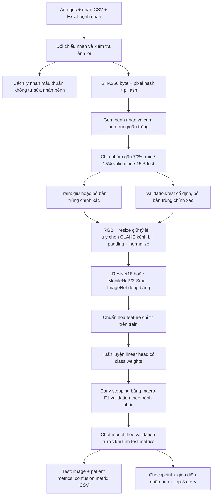

# Phân loại tổn thương thanh quản từ ảnh CE-NBI

Dự án nghiên cứu chạy cục bộ: audit dữ liệu → chia bệnh nhân → benchmark → chọn model bằng validation → nhập ảnh để nhận gợi ý phân loại. Không phải thiết bị chẩn đoán đã thẩm định. Dữ liệu hiện tại chưa đủ để chẩn đoán mọi bệnh vùng họng, viêm họng, viêm amidan hay ảnh nội soi ánh sáng trắng.

## Chạy nhanh

Các lệnh thực hiện tại thư mục dự án. Môi trường `.venv` đã được cài trong lần chạy này.

```bash
# Tạo lại môi trường nếu chuyển máy (Python >=3.11)
python3 -m venv .venv
.venv/bin/python -m pip install -e .

# Audit + chia dữ liệu, không sửa thư mục gốc
.venv/bin/python -m throat_ai.prepare

# Benchmark 2 backbone × 2 preprocessing × 2 duplicate policies = 8 runs / seed
.venv/bin/python -m throat_ai.benchmark --epochs 80 --patience 10 --seeds 42

# Mở giao diện upload ảnh, chỉ lắng nghe trên localhost
.venv/bin/streamlit run app.py --server.address 127.0.0.1

# Hoặc dự đoán bằng dòng lệnh
.venv/bin/python -m throat_ai.predict '/đường/dẫn/ảnh.jpg' --modality CE-NBI

# Kiểm tra logic chia tập, preprocessing
.venv/bin/pytest -q
```

`requirements-lock.txt` ghi môi trường lần chạy thực tế trên macOS ARM. Dùng `pyproject.toml` khi cài nền tảng khác. Đường dẫn dữ liệu mặc định nằm trong `src/throat_ai/prepare.py`; `--root` cho phép đổi nguồn CE-NBI. Với nguồn mới, phải đối chiếu bảng bệnh nhân tương đương; bước đối chiếu Excel hiện áp dụng tự động cho nguồn mặc định. Không chạy hai benchmark cùng lúc vì chúng dùng chung bảng tổng hợp và best_model.json.

## Pipeline



## Dữ liệu và nhãn

- CE-NBI: 11.144 ảnh, 210 bệnh nhân trước audit. Ảnh cận cảnh mạch máu thanh quản, không phải bộ ảnh mọi vùng họng. Không có nhóm người khỏe mạnh.
- 10 lớp kế thừa manifest `larynx_histology.csv`: carcinoma tại chỗ, nang dây thanh, loạn sản độ cao, tăng sừng, loạn sản độ thấp, lành tính khác, u nhú, polyp, phù Reinke và SCC.
- `Other_benign` gộp các nhóm hiếm: amyloidosis, bamboo node (tên thư mục nguồn `Namboo_node`), granuloma, hemangioma, hyperplasia, inflammation và nodule. Đầu ra không phân biệt từng bệnh trong nhóm này. `Papillomatosis` được ánh xạ sang `Papilloma` theo manifest nguồn; `Squamous hyperplasia` trong Excel tương ứng thư mục `Hyperplasia`.
- Không hiểu nhãn `Malignant` của nguồn là “ung thư xâm lấn” cho mọi ảnh: nhóm này còn gồm loạn sản độ cao và carcinoma tại chỗ. Pipeline chính phân loại 10 nhóm, không gán lại bệnh học theo tên binary.
- Patient092: Excel ghi SCC nhưng loại tổn thương Benign, thư mục ghi Malignant → cách ly 45 ảnh chờ kiểm tra.
- 54 ảnh trùng pixel nhưng khác lớp tại Patient060/061 và Patient148/166 → cách ly cả hai phía. Không chọn một nhãn theo đa số.
- Còn 11.045 ảnh / 209 bệnh nhân. 4 bản trùng cùng nhãn được giữ hoặc bỏ trong ablation train.
- BAGLS-VF dùng cho phân đoạn thanh môn/dây thanh. `archive-2` chứa BAGLS có metadata tình trạng rối loạn và video, nhưng không tự động tương đương nhãn mô bệnh học CE-NBI. Chưa train nhánh segmentation hoặc trộn các bộ này vào classifier.

`reports/label_file_audit.csv` kiểm tra dòng/path trùng trong từng manifest; ba manifest mô tả các tác vụ khác nhau, không phải ba bộ ảnh độc lập. Nhiều ảnh cùng nhãn bệnh là hợp lệ, không phải lỗi duplicate label. `reports/patient_label_audit.json` và `patient_label_issues.csv` kiểm tra bảng Excel; hàng trống và file khóa Excel `~$...` không phải nhãn.

## Chống leakage và thiết kế duplicate ablation

1. SHA256 phát hiện trùng file; pixel hash phát hiện cùng ảnh sau decode dù metadata khác. Nhãn mâu thuẫn bị cách ly trước chia tập.
2. Gom tất cả ảnh cùng bệnh nhân. pHash Hamming ≤4 tạo các cặp nghi gần trùng; liên kết bắc cầu được gom cùng split, kể cả khác mã bệnh nhân. pHash có thể gom nhầm ảnh giống nhau; danh sách cần bác sĩ/người quản lý dữ liệu xem lại. Không tự xóa ảnh chỉ vì pHash gần nhau.
3. Chia nhóm bằng seed 42, chọn phương án cân đối số bệnh nhân mỗi lớp, không dùng dự đoán hoặc test score. Tỷ lệ 70:15:15 áp dụng gần đúng theo bệnh nhân; không ép số frame bằng tỷ lệ khi điều đó làm cùng bệnh nhân lọt nhiều tập. 80:20:10 bị từ chối vì tổng 110%; nếu cần phương án khác, dùng tỷ lệ hợp lệ như 80:10:10.
4. Validation/test giống hệt giữa tất cả model và chính sách train, luôn bỏ bản trùng chính xác. “Không xử lý duplicate” trong benchmark nghĩa là giữ duplicate trong train; vẫn chặn trùng xuyên split. Không cố tạo benchmark bị leakage để lấy điểm cao.
5. Chỉ train được dùng fit mean/std feature và class weights. Encoder ImageNet ở chế độ eval, không cập nhật BatchNorm bằng validation/test. Không augmentation trong baseline linear probe này.
6. Early stopping monitor **validation patient macro-F1**, patience 10, min_delta 0.0001, tối đa 80 epoch; khôi phục head ở epoch tốt nhất.
7. Xếp hạng cấu hình bằng validation patient macro-F1 trước khi xuất test metrics. Test chỉ báo cáo sau khi chốt cấu hình, không chọn model theo test. Nếu tiếp tục sửa mô hình sau khi xem test, cần external test mới để có đánh giá cuối độc lập.
8. Không thể chứng minh hết leakage tiềm ẩn từ ảnh đã crop/biến đổi mạnh hoặc bệnh nhân bị cấp hai ID mà thiếu metadata. Kiểm tra ngoài bệnh viện vẫn cần thiết.

## Benchmark và kết quả

Baseline dùng **frozen pretrained encoder + linear head**, không phải fine-tuning toàn bộ CNN. Tận dụng Metal/MPS để trích feature trên Apple Silicon, huấn luyện head trên CPU. Cả hai backbone dùng cùng ảnh 224×224, resize giữ tỷ lệ, padding đen. CLAHE clipLimit=2, tileGridSize=8×8 trên kênh L của LAB sau resize và trước padding; không equalize riêng từng kênh RGB.

- `runs/benchmark_results.csv`: một dòng mỗi lần train hoàn tất, nối thêm khi chạy lại; có architecture, seed, CLAHE, duplicate policy, split hash, chế độ train, learning rate, epoch tốt nhất, early stopping, thời gian, số ảnh và metrics.
- `runs/<suite>_benchmark.csv`: trạng thái từng run trong suite, gồm cả lỗi nếu có.
- `runs/<run_id>/epochs.csv`: loss và validation metrics từng epoch.
- `runs/<run_id>/test_per_class.csv`, `test_confusion.csv`, `test_predictions.csv`: kiểm tra từng lớp/ảnh; tương tự cho validation.
- Patient metrics được tính bằng trung bình vector softmax các ảnh cùng bệnh nhân, rồi lấy argmax. Image accuracy có thể thiên lệch về bệnh nhân nhiều frame.
- `runs/best_model.json`: checkpoint chọn bằng validation. Chạy lại benchmark sẽ cập nhật lựa chọn này, nhưng không xóa các run cũ.
- `reports/split_distribution.csv`: phân bố lớp và bệnh nhân thực tế.

Một seed chỉ là baseline; chưa có khoảng tin cậy khái quát hoặc kết luận architecture nào luôn tốt nhất. Có thể chạy một suite mới với `--seeds 42 123 2026` để đánh giá độ nhạy initialization trên split cố định; nếu muốn quyết định theo trung bình nhiều seed, cần định nghĩa tiêu chí chọn theo nhóm cấu hình trước khi mở test. CLI hiện chọn checkpoint đơn có validation tốt nhất, không thực hiện chọn theo trung bình seed.

## Đầu ra khi nhập ảnh

Giao diện yêu cầu khai báo ảnh CE-NBI thanh quản; ảnh ánh sáng trắng/họng/amidan ngoài phạm vi bị từ chối. Đây là khai báo của người dùng, chưa phải bộ phân loại giải phẫu tự động. Model trả top-3 nhóm và điểm softmax. Ngưỡng 0.6 là heuristic thử nghiệm chưa hiệu chuẩn, không phải độ tin cậy y khoa, và không bảo đảm phát hiện ảnh ngoài phân phối. Không có lớp bình thường nên không dùng để kết luận một người “không bệnh”. Chưa có quality classifier, OOD detector, xác nhận giải phẫu hay Grad-CAM đã được đánh giá.

## PDF người dùng

Đã trích đọc 40 trang; phần phù hợp: trang 27–30 mô tả vùng họng và khám họng miệng, trang 32 về amidan, trang 33–37 về hạ họng/thanh quản và bệnh thường gặp. Dùng làm ngữ cảnh giải phẫu trong thiết kế, không dùng các hình minh họa làm mẫu train hoặc tự suy diễn nhãn. Phần họng rộng hơn phạm vi dữ liệu CE-NBI hiện có.

## Nguồn bổ sung đã kiểm tra

Xem `reports/data_sources.csv` và `reports/SOURCES.md`. Đã tải bộ Moccia2017 1.320 patch NBI từ Zenodo, xác thực MD5, tạo manifest với nhãn mô nguyên bản. Bộ này phục vụ tác vụ mô/vi mạch khác, chưa trộn vào 10 lớp bệnh. ENTRep phù hợp hơn cho lớp giải phẫu throat nhưng cần lấy dữ liệu và kiểm tra điều khoản/nhãn bệnh/ID bệnh nhân. Laryngoscope8 bổ sung ảnh nội soi thanh quản thông thường và lớp normal, cần kiểm tra truy cập, quyền sử dụng và ánh xạ bệnh nhân trước train.
